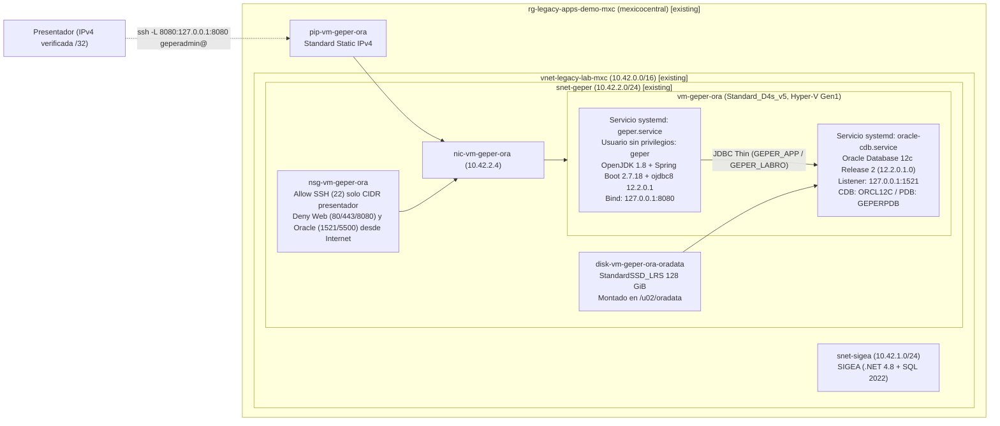

# Infraestructura Azure (Bicep) — GEPER (Java 8 / Spring Boot 2.7 / Oracle Database 12c R2)

> **Laboratorio ficticio de demostración.** Institución ficticia: **Corporación Regional Monte Azul** (GEPER). Este directorio contiene los módulos **Bicep** y scripts operativos para desplegar **GEPER** sobre **Oracle Linux 7** y **Oracle Database 12c Release 2 (`12.2.0.1.0`)** en **Azure Mexico Central (`mexicocentral`)**, consumiendo la red compartida aprovisionada por `legacy-academic-portal-dotnet`.

---

## 1. Arquitectura y relación con la infraestructura compartida

Este repositorio **no duplica** la creación del grupo de recursos ni de la red virtual. Recibe como parámetros los nombres del grupo de recursos (`rg-legacy-apps-demo-mxc`), la VNet (`vnet-legacy-lab-mxc`) y la subred (`snet-geper`) creados por `legacy-academic-portal-dotnet/infra/azure/main.bicep` y los referencia mediante la palabra clave `existing` de Bicep.



---

## 2. Módulos Bicep, recursos y parámetros principales

### 2.1 Tabla de módulos y responsabilidad

| Archivo / Módulo | Alcance (`targetScope`) | Responsabilidad y recursos administrados |
|---|---|---|
| [`main.bicep`](./main.bicep) | `subscription` | Referencia el grupo de recursos existente `rg-legacy-apps-demo-mxc` (`existing`) y coordina los módulos de seguridad de red y cómputo de GEPER en `mexicocentral`. |
| [`modules/geper-nsg.bicep`](./modules/geper-nsg.bicep) | `resourceGroup` | Crea `nsg-vm-geper-ora`. Permite SSH (`22/TCP`) **únicamente** si `presenterAllowedCidr` contiene un CIDR válido distinto de `0.0.0.0/0` o `*`, y bloquea explícitamente `80`, `443`, `8080`, `1521` y `5500` desde `Internet`. |
| [`modules/geper-vm.bicep`](./modules/geper-vm.bicep) | `resourceGroup` | Referencia `vnet-legacy-lab-mxc` y `snet-geper` como recursos `existing`. Crea `pip-vm-geper-ora`, `nic-vm-geper-ora`, el disco administrado persistente `disk-vm-geper-ora-oradata` (`LUN 0`, `deleteOption: 'Detach'`) y la VM `vm-geper-ora`. |
| [`main.bicepparam`](./main.bicepparam) | `subscription` | Plantilla de parámetros sin secretos ni IPs privadas; lee `GEPER_VM_SSH_PUBLIC_KEY` y `GEPER_VM_ADMIN_PASSWORD` desde el entorno. |

### 2.2 Parámetros principales de `main.bicep`

| Parámetro | Tipo | Valor predeterminado | Descripción |
|---|---|---|---|
| `location` | `string` | `'mexicocentral'` | Región Azure fija y restringida (`@allowed(['mexicocentral'])`). |
| `existingResourceGroupName` | `string` | `'rg-legacy-apps-demo-mxc'` | Nombre del grupo de recursos existente creado por el repositorio .NET. |
| `existingVnetName` | `string` | `'vnet-legacy-lab-mxc'` | Nombre de la VNet existente en el grupo de recursos. |
| `existingSubnetName` | `string` | `'snet-geper'` | Nombre de la subred existente dedicada a GEPER (`10.42.2.0/24`). |
| `presenterAllowedCidr` | `string` | `''` | Prefijo IPv4 `/32` verificado del presentador para SSH (puerto 22). Si es vacío `''`, no se crea regla `Allow` de entrada SSH desde Internet. |
| `enablePublicIp` | `bool` | `true` | Crea o no la IP pública estática para el túnel SSH autenticado. |
| `geperVmName` | `string` | `'vm-geper-ora'` | Nombre de la VM Linux de GEPER. |
| `geperVmSize` | `string` | `'Standard_D4s_v5'` | Tamaño de VM (4 vCPU, 16 GiB RAM, soporta Hyper-V `V1` y `V2`). |
| `geperImagePublisher` | `string` | `'Oracle'` | Publisher oficial en Azure Marketplace. |
| `geperImageOffer` | `string` | `'oracle-database'` | Offer de imagen (`oracle-database` con binarios 12.2.0.1 preinstalados o `Oracle-Linux` para instalación desde archivo zip). |
| `geperImageSku` | `string` | `'oracle_db_12_2_0_1_ee'` | SKU de Oracle Database 12c Release 2 (`12.2.0.1.0`) sobre Oracle Linux 7.4 (`V1`). |
| `geperImageVersion` | `string` | `'12.2.01'` | Versión exacta registrada de la imagen en `mexicocentral`. |
| `osDiskSku` / `dataDiskSku` | `string` | `'StandardSSD_LRS'` | Tipo de disco administrado (`StandardSSD_LRS` o `Premium_LRS`). |
| `osDiskSizeGb` / `dataDiskSizeGb` | `int` | `128` | Tamaño en GiB del disco de SO y del disco persistente `/u02` para Oracle. |
| `adminUsername` | `string` | `'geperadmin'` | Usuario administrador Linux para administración y túnel SSH. |
| `sshPublicKey` | `string` | `''` | Clave pública SSH (`ed25519` / `rsa`) configurada en `/home/geperadmin/.ssh/authorized_keys`. |
| `adminPassword` | `string` (`@secure()`) | `''` | Contraseña administrativa opcional; nunca se incluye en outputs. |

---

## 3. Obtención y uso de medios de Oracle Database 12c Release 2 (`12.2.0.1`)

El laboratorio soporta dos modalidades para disponer de **Oracle Database 12c Release 2 (`12.2.0.1.0`)** nativo en la VM sobre Oracle Linux 7 (combinación certificada por el fabricante para 12.2.0.1 en Linux x86-64):

1. **Modalidad predeterminada en Azure (`Oracle:oracle-database:oracle_db_12_2_0_1_ee:12.2.01` o `oracle_db_12_2_0_1_se:12.2.01`):**
   Imagen publicada directamente por Oracle en Azure Marketplace (`mexicocentral`) bajo términos BYOL / OTN Developer, que provee **Oracle Linux Server 7.4** con los binarios nativos de **Oracle Database 12c Release 2 (`12.2.0.1.0`)** instalados en `/u01/app/oracle/product/12.2.0/dbhome_1`.
2. **Modalidad de instalación desde medio privado (`linuxx64_12201_database.zip`) sobre imagen base Oracle Linux 7 (`Oracle:Oracle-Linux:7.6:latest`):**
   - **Dónde descargarlo:** Con su cuenta Oracle bajo la licencia OTN Developer aplicable desde [Oracle Software Delivery Cloud (edelivery.oracle.com)](https://edelivery.oracle.com/) buscando *"Oracle Database 12c Release 2 (12.2.0.1.0) for Linux x86-64"* (Part Number **`V839960-01.zip`**, equivalente a **`linuxx64_12201_database.zip`**, tamaño `3,453,696,911` bytes).
   - **Verificación de integridad oficial:**
     - **SHA-256:** `f8f9fa22f3c42f1fb2bc9ff2bb34d92b788d157d7d4b37541c3832860ebca677`
     - **SHA-1:** `2130ef6f428ef6db577bd90c8ea7fd4fb2ffef79`
   - **Dónde colocarlo de forma privada:** Copie el archivo por `scp` autenticado a `/var/opt/geper/installers/linuxx64_12201_database.zip` en la VM (`chmod 600`). El script [`scripts/bootstrap-vm-geper.sh`](./scripts/bootstrap-vm-geper.sh) verifica automáticamente el SHA-256 antes de ejecutar `runInstaller -silent`. **Nunca publique este archivo ni imágenes que lo contengan en GitHub o registros públicos** (`*.zip` está bloqueado en `.gitignore`).

> **Nota sobre soporte y certificación:** Oracle Linux 7 con kernel UEK R4 (`4.1.12`) es un sistema operativo certificado originalmente para Oracle Database 12.2.0.1. Sin embargo, tanto Oracle Database 12.2.0.1 como Spring Boot 2.7.x se encuentran fuera de soporte estándar de fabricante y se conservan deliberadamente como línea base del laboratorio de modernización.

---

## 4. Adaptaciones realizadas en GEPER para Oracle 12c Release 2 (`12.2.0.1`) y Java 8

| Archivo | Cambio realizado | Motivo |
|---|---|---|
| [`pom.xml`](../../pom.xml) | Pin de `<ojdbc.version>12.2.0.1</ojdbc.version>` (`com.oracle.database.jdbc:ojdbc8:12.2.0.1`) con bytecode target `1.8` | Alinea la versión exacta del driver `ojdbc8` con Oracle Database 12c R2 (`12.2.0.1`) y Java 8 (JDBC 4.2). |
| [`src/main/resources/application.yml`](../../src/main/resources/application.yml) y [`config/application-local-lab.yml.example`](../../config/application-local-lab.yml.example) | Cambio del servicio PDB predeterminado a `jdbc:oracle:thin:@//localhost:1521/GEPERPDB` | Sustituye el nombre de servicio `FREEPDB1` (propio de Oracle 23c Free) por la PDB dedicada `GEPERPDB` creada en Oracle 12c R2. |
| [`db/accounts/01_create_accounts.sql`](../../db/accounts/01_create_accounts.sql) | Bloques PL/SQL idempotentes con asignación explícita de `DEFAULT TABLESPACE USERS TEMPORARY TABLESPACE TEMP` | Garantiza creación repetible de `GEPER_OWNER`, `GEPER_APP` y `GEPER_LABRO` en la PDB `GEPERPDB` de Oracle 12.2 sin errores por usuarios preexistentes. |
| [`db/schema/02_schema.sql`](../../db/schema/02_schema.sql) y [`db/data/03_synthetic_data.sql`](../../db/data/03_synthetic_data.sql) | `DEPARTMENTS_SEQ START WITH 70` y avance explícito de `DEPARTMENTS_SEQ >= 60` tras cargar los departamentos `10..60` | Corrige colisión de clave primaria (`ORA-00001`) al crear un nuevo departamento desde la aplicación cuando existen los departamentos sembrados `50` y `60`. |
| [`src/test/java/com/monteazul/geper/GeperIntegrationTest.java`](../../src/test/java/com/monteazul/geper/GeperIntegrationTest.java) | Adición de la prueba transaccional `createDepartmentUsesSequenceAndPersists` | Verifica contra Oracle 12c R2 que el alta de departamentos utiliza `DEPARTMENTS_SEQ` sin colisionar con el dataset base. |

---

## 5. Comandos exactos para compilar, validar, ejecutar `what-if` y desplegar

> **Requisito previo:** Haber desplegado primero `legacy-academic-portal-dotnet/infra/azure/main.bicep`, que crea el grupo de recursos `rg-legacy-apps-demo-mxc` y la VNet `vnet-legacy-lab-mxc` con la subred `snet-geper`.

```powershell
# 1. Seleccionar explícitamente la suscripción autorizada
az account set --subscription "<SUBSCRIPTION_ID>"

# 2. Definir la clave pública SSH (y opcionalmente contraseña de respaldo) en variables de entorno
$env:GEPER_VM_SSH_PUBLIC_KEY = Get-Content "$HOME\.ssh\id_ed25519.pub" -Raw
$env:GEPER_VM_ADMIN_PASSWORD = "<PASSWORD_ROBUSTA_OPCIONAL>"

# 3. Compilar Bicep y validar parámetros
az bicep build --file infra/azure/main.bicep --stdout | Out-Null
az bicep build-params --file infra/azure/main.bicepparam --stdout | Out-Null

# 4. Validación ARM
az deployment sub validate `
  --location mexicocentral `
  --name validate-geper-mxc `
  --parameters infra/azure/main.bicepparam `
  --parameters presenterAllowedCidr="<IP_PUBLICA_PRESENTADOR>/32"

# 5. Análisis preliminar con what-if
az deployment sub what-if `
  --location mexicocentral `
  --name whatif-geper-mxc `
  --parameters infra/azure/main.bicepparam `
  --parameters presenterAllowedCidr="<IP_PUBLICA_PRESENTADOR>/32"

# 6. Ejecutar el despliegue autorizado
az deployment sub create `
  --location mexicocentral `
  --name deploy-geper-mxc `
  --parameters infra/azure/main.bicepparam `
  --parameters presenterAllowedCidr="<IP_PUBLICA_PRESENTADOR>/32"
```

También puede utilizar el script operativo incluido:

```powershell
./infra/azure/scripts/manage-lab.ps1 -Action Validate -SubscriptionId "<SUBSCRIPTION_ID>"
./infra/azure/scripts/manage-lab.ps1 -Action Deploy   -SubscriptionId "<SUBSCRIPTION_ID>" -PresenterAllowedCidr "<IP_PUBLICA_PRESENTADOR>/32"
```

---

## 6. Configuración de Oracle 12c R2, servicio Linux e inicio automático

El script [`scripts/bootstrap-vm-geper.sh`](./scripts/bootstrap-vm-geper.sh) realiza el aprovisionamiento persistente e idempotente dentro de `vm-geper-ora`:

1. **Almacenamiento persistente (`/u02`):** Formatea el disco administrado `disk-vm-geper-ora-oradata` (`LUN 0`) en `ext4` (solo si no tiene sistema de archivos), registra su `UUID` en `/etc/fstab` con `nofail` y monta `/u02/oradata` con propietario `oracle:oinstall` (`0750`).
2. **Listener en loopback y creación de CDB/PDB:** Configura `listener.ora` en `127.0.0.1:1521` (nunca expuesto a la red externa), crea la CDB `ORCL12C` y la PDB **`GEPERPDB`** en `/u02/oradata` mediante `dbca -silent`, ejecuta `ALTER PLUGGABLE DATABASE GEPERPDB SAVE STATE;` y habilita la unidad systemd `oracle-cdb.service`.
3. **Cuentas, esquema, trigger y datos sintéticos:** Ejecuta SQL*Plus con `WHENEVER SQLERROR EXIT SQL.SQLCODE` (falla ante cualquier error SQL inesperado), crea el tablespace `USERS` en `GEPERPDB` si no existe, aprovisiona `GEPER_OWNER`, `GEPER_APP` y `GEPER_LABRO` con contraseñas aleatorias únicas almacenadas en `/etc/geper/credentials.env` (`0600`), y en la instalación inicial carga `02_schema.sql` (incluyendo el trigger `UPDATE_JOB_HISTORY`) y `03_synthetic_data.sql`.
4. **Servicio Java sin privilegios (`geper.service`):** Instala OpenJDK 8, crea el usuario de sistema sin privilegios `geper` (`/sbin/nologin`), protege `/etc/geper/geper.env` (`0640` `root:geper`) con `ENABLE_VULNERABILITY_LABS=false` y `SERVER_ADDRESS=127.0.0.1`, y habilita `geper.service` en `systemd`.

---

## 7. Acceso del presentador (túnel SSH) y laboratorios de seguridad

- **Abrir GEPER desde la estación del presentador mediante túnel SSH autenticado:**
  1. Asegúrese de que su IPv4 pública `/32` esté autorizada en `presenterAllowedCidr` del NSG `nsg-vm-geper-ora`.
  2. Ejecute desde su estación de trabajo:
     ```powershell
     ./infra/azure/scripts/manage-lab.ps1 -Action Tunnel -SshKeyPath "<RUTA_CLAVE_PRIVADA_SSH>"
     # Equivalente a: ssh -i <CLAVE> -N -L 8080:127.0.0.1:8080 geperadmin@<IP_PUBLICA_GEPER>
     ```
  3. Abra su navegador local en **`http://localhost:8080/`**.
- **Activar temporalmente los laboratorios de seguridad (`JAVA-SQLI-01` y `JAVA-XSS-01`) por localhost:**
  Dentro de `vm-geper-ora` por SSH:
  ```bash
  sudo /var/opt/geper/stage/scripts/set-lab-mode-geper.sh true
  ```
  Navegue a `http://localhost:8080/lab` a través del túnel SSH (verá la banda *"Laboratorio vulnerable activo · Datos ficticios"*).
- **Desactivar los laboratorios y limpiar observaciones de XSS después del ejercicio:**
  ```bash
  sudo /var/opt/geper/stage/scripts/set-lab-mode-geper.sh false
  sudo /var/opt/geper/stage/scripts/reset-dataset-geper.sh --mode lab-only
  ```

---

## 8. Operación, restablecimiento de datos, desasignación y eliminación

```powershell
# Iniciar la VM de GEPER
./infra/azure/scripts/manage-lab.ps1 -Action Start -SubscriptionId "<SUBSCRIPTION_ID>"

# Desasignar la VM de GEPER al finalizar la demostración (detiene el cobro por cómputo)
./infra/azure/scripts/manage-lab.ps1 -Action Deallocate -SubscriptionId "<SUBSCRIPTION_ID>"

# Restablecer explícitamente el dataset sintético (30 empleados, 6 departamentos, 10 puestos, suma salarial 99800)
./infra/azure/scripts/manage-lab.ps1 -Action ResetDataset -SubscriptionId "<SUBSCRIPTION_ID>"

# Eliminar exclusivamente los recursos de GEPER cuando ya no se requieran
./infra/azure/scripts/manage-lab.ps1 -Action Teardown -SubscriptionId "<SUBSCRIPTION_ID>" -ConfirmTeardown
```
